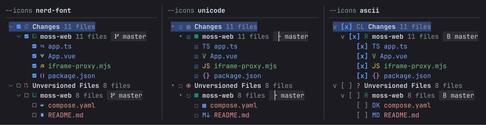

# IGit

Open the same multi-repository Git workspace with `igit` or `ig`. Switch between Commit, Log, Push, Branch, Stash, and Conflicts in one terminal session. Rust + Ratatui + Crossterm render the interface, while system Git performs repository operations. Use a terminal with ANSI and mouse reporting support, such as kitty or Terminal; at least 120 columns × 36 rows is recommended.

The interface, help, and documentation use English. Repository names, paths, commit messages, and file content retain Unicode support.

## Project Documentation

- [Start a new session: AGENTS.md](AGENTS.md) — Find relevant documentation and source files, with local practice and verification commands.
- [Product requirements (PRD)](docs/prd.md) — Use cases, delivered scope, pending work, and acceptance criteria.
- [Interaction design](docs/design.md) — Layout, focus, keyboard and mouse rules for all panels, plus IDEA-based Commit acceptance criteria.
- [Architecture](docs/architecture.md) — Event routing, review of Git writes, and failure handling across repositories.
- [Installation and updates](docs/installation.md) — Native installers, release channels, and `igit update`.
- [Releasing](docs/releasing.md) — Beta/stable release skill, CI targets, downloadable archives, and verification.

Original design references: [Four-panel overview](docs/reference/IGit-Overview.png) · [Interactive prototype](docs/reference/IGit.html) · [Illustrated design notes](docs/reference/IGit-Design.html). Both HTML files use demo data and can be opened in a local browser.

## Getting Started

Install the beta on macOS (Intel/Apple Silicon) or Linux (x86_64/ARM64):

```sh
curl -fsSL https://igit.yelog.org/install-beta.sh | sh
```

On Windows x86_64, run in PowerShell:

```powershell
$env:IGIT_CHANNEL = 'beta'
powershell.exe -NoProfile -ExecutionPolicy Bypass -Command "irm https://igit.yelog.org/install.ps1.txt -ErrorAction Stop | iex"
```

Open a new terminal after installation. System Git and curl are required;
Unix installers also require Python 3.9+. For stable releases, use `install.sh`
on Unix or set the PowerShell channel to `stable`. A channel becomes available
after its first release. See [installation options](docs/installation.md) for
custom paths, requirements, archive downloads, and troubleshooting.

Native builds containing the updater support `igit update --check` and
`igit update` (also `ig update`), retaining the installed channel. The published
`v0.1.0-beta.1` predates that command; rerun its installer to update it.

The bottom-left status line shows the running version. Press `F9` in normal
mode, click the version/update label, or choose **Update IGit** in Actions to
open Update Center. It checks in the background 1.5 seconds after startup,
using a 24-hour cache. Available updates also appear in notifications;
automatic no-update and failure results stay quiet. Choose **Update** to
install the reviewed release. The
dialog shows download progress and the current installation stage; choose
**Run in background** to keep working. When it finishes, choose **Restart now**
or relaunch later. Cargo/manual copies offer **How to update** for their
original installation method. See
[update settings](docs/configuration.md#update-checks).

Build and launch from this source directory. On macOS/Linux, use the serial entry point below; on Windows, replace `python3 scripts/cargo_serial.py` with `cargo`. To use `igit` or `ig` in any workspace, optionally install both commands into Cargo's bin directory:

```sh
python3 scripts/cargo_serial.py build --release --locked
./target-serial/release/igit /path/to/workspace
./target-serial/release/ig /path/to/workspace

# Optional: install both commands into Cargo's bin directory
python3 scripts/cargo_serial.py install --locked --path .
```

By default, `igit` and `ig` discover repositories from the current directory. You can pass a directory; `--list-roots [directory]` only lists discovered working trees. Discovery supports ordinary Git roots, nested repositories at multiple levels, initialized submodules, and linked worktrees. Bare repositories are not editable targets. Discovery does not recurse into symlinked directories or common dependency/build directories such as node_modules, target, .venv, and build, and does not initialize or clone submodules. To use a repository inside a directory normally skipped, start directly in that directory.

The Commit layout appears before repository discovery starts, with the normal tab
bar, Changes, message composer, and preview in place. Changes shows an animated
stage indicator and tree placeholders; the preview waits for data. Discovered root
counts and elapsed time (after five seconds) provide context without estimating
completion. Actions remain disabled until changes and conflict checks finish;
resizing and `Esc`, `q`, or `Ctrl-C` to quit remain available. Narrow terminals use
the same compact layout as the loaded panel. Direct panel launches keep the
requested tab selected while loading. Log history loads in the background
the first time you open Log, and you can return to Commit while it loads.

Open a panel directly, or inspect one file's history:

```sh
igit commit /path/to/workspace
igit log
igit push
igit branch
igit stash
igit log -- "src/example.js"
```

`ig` accepts the same arguments. `log` accepts either a workspace directory or
a file path, resolved from the invocation directory. A file need not still exist
in the working tree. Use `--` before literal option-like paths, and `igit -- log`
to open a directory named `log` in the default Commit panel. A file opens an
additional **History: filename** Log tab: commits on the left, a live read-only
Diff on the right. Ordinary commits show Before/After; two-parent merges show
Parent 1/Result/Parent 2. History follows Git's rename detection. Use `Tab` or
`Ctrl-W h/l` between history and Diff; inside Diff, `[/]` selects a revision,
`n/p` selects a change, and `Esc` returns to history. Close a history tab with
its close control or `Ctrl-W c` to return to the normal Log tab.

Press `e` in either File History pane for **Show File at Revision**. It opens
the selected commit's complete file using its historical path. In `igit.nvim`,
this opens a read-only buffer named like `user.ts (69028162)`, with syntax
highlighting and the IGit session retained. Standalone IGit opens a temporary
read-only snapshot in Git's configured editor; use an editor command that waits
until the file is closed. A deletion commit has no file to open: select an earlier
commit. Empty files are supported; binary, non-UTF-8, and files over 512 KiB report
an error. Customize the shortcut with `keybindings.log.show-file-at-revision`.
Both the native binary and companion plugin need this feature's implementation.

**Choose terminal icons.** The default uses Nerd Font icons for repositories, branches, file types, and actions. If icons appear as boxes, try `ig --icons unicode`; for text markers such as `[x]`, use `ig --icons ascii`. Both commands accept `--icons mode [directory]`. The selected mode applies to all panels and any workspace reopened during the same run.

| Mode | Use case |
| --- | --- |
| `nerd-font` (default) | The local terminal uses Nerd Font 3.x or Symbols Nerd Font Mono. Icons distinguish repositories, submodules, branches, tags, and common file types. |
| `unicode` | No dedicated font; uses standard symbols and file type abbreviations, such as `☑` and `TS`. |
| `ascii` | Uses ASCII icons and commit graph markers, such as `[x]`, `[-]`, `[ ]`, and `[!]`. UI text, borders, filenames, and patches may still contain Unicode. |

All panels share file icons for common languages, including Java, Kotlin, Scala, Groovy, Python, Go, Rust, C / C++ / C# / F#, Swift, Dart, PHP, Ruby, and Lua. React `.jsx` / `.tsx` files use React icons distinct from ordinary JavaScript / TypeScript. Vue, Svelte, Astro, XML, SQL, GraphQL, Shell, PowerShell, and common build files also have dedicated markers. Unicode / ASCII modes use readable abbreviations such as `Jv`, `Py`, `JSX`, and `TSX`; unknown types keep a generic file icon.

IGit does not detect or install fonts. Over SSH, glyphs depend on the font configured in your local terminal.



**Try a real practice workspace first.** The script creates repositories only in a new temporary directory. All remotes are local; nothing is pushed to a hosting service:

```sh
demo_workspace="$(sh examples/demo-workspace.sh)"
igit "$demo_workspace"
```

The workspace contains two ordinary repositories, one initialized submodule, and three bare remotes. Each ordinary repository has changes to commit and commits to push. The submodule has one real conflict and two independent changes. The script prints the workspace path and leaves your practice results in place.

## Neovim

The companion `igit.nvim` plugin runs this same executable in a Neovim terminal.
It supports floating windows, left/right/bottom splits, and tab pages. With a
local plugin checkout in Neovim's runtime path:

```lua
require("igit").setup({
  command = "igit", -- or the absolute path to a freshly built executable
  window = { layout = "float", width = 0.9, height = 0.9 },
})
```

Use `:Igit`, `:Igit commit`, `:Igit log`, `:Igit push`, `:Igit branch`, or
`:Igit stash`. `:Igit log %` shows the originating buffer's file history;
an explicit filename also works. The plugin supplies an interactive lowercase
`:igit` abbreviation because Neovim user commands must begin with an uppercase
letter. Scripts and mappings should use `:Igit` or `require("igit").open(...)`.
`:IgitClose` hides the plugin window while retaining its running session.
The plugin's README and `:help igit.nvim` document all window and session options.
Build this source version before using panel/file arguments with an older installed binary.

## Edit a working file

In Commit's Changes tree, highlight a file and press `e` or `E`. The highlighted
working copy opens independently of its checkbox. Editing updates the working
copy; existing staged content remains the commit candidate until reviewed.
Containers, deleted files and submodule directories require a real file target.

Standalone IGit follows [Git's editor selection](https://git-scm.com/docs/git-var.html):
`GIT_EDITOR`, `core.editor`, `VISUAL`, `EDITOR`, then Git's compiled default
(usually `vi`). Editor commands can include flags, for example `nvim`,
`vim`, or `code --wait`. IGit restores the normal terminal while the editor runs,
then resumes and refreshes Changes when it exits. Launch/exit errors return to
the workspace with a notification.

Inside `igit.nvim`, `e` opens the file in the same Neovim instance and reuses an
existing buffer, including unsaved text. A floating IGit window hides while its
process, checked files and drafts remain available; reopen it with the same
command or your normal IGit shortcut. Splits stay visible, and tab sessions stay
open while focus returns to the source editing window. Save the file normally;
IGit's file watcher updates the working-copy status and preview. The plugin and
native executable must both contain this integration.

## Review a file before committing

Select a file in Commit's Changes tree to show a read-only **Before / After**
comparison beside it. The preview uses the same syntax highlighting, line
numbers, aligned changes, context folding, and synchronized scrolling as file
history. Staged files compare **HEAD → Index**; files without staged changes
compare **Index → Working tree**. Later unstaged edits stay outside a staged
file's preview and commit candidate. Added and deleted files have an empty side.
Selecting a group or directory shows its Overview.

Focus Preview with `Enter`, `Tab`, or a click. Use `[` / `]` to focus Before /
After, `n/p` for differences, `f` to fold context, `z` to zoom a revision, and
`h/l` to scroll horizontally. `/` searches the focused revision, including folded
lines; `n/N` visits matches. Drag to copy, or use `Ctrl-A` then `Ctrl-C` to copy
that revision's exact text. `Tab/F6` still switches workspace panes and `Esc`
returns to Changes after clearing search/selection. Below 48 preview columns,
one revision is visible at a time; `[` / `]` switches sides. Binary, oversized,
or unsupported content falls back to an explained patch.

In Changes and the message actions, `Esc` keeps focus and preview visibility
unchanged. While editing a message, `Esc` saves the draft and leaves Message focused.

## Stage and unstage hunks

In Commit, highlight a tracked file and press `Ctrl-G`, or click **Hunks** in
the Changes toolbar. **Unstaged** compares the index with the working copy;
**Staged** compares HEAD with the index. `Tab` switches sides (`u` / `s` select
them directly), `n/p` selects a hunk, and `j/k` or the wheel scrolls it.
Press `Space` or `Enter` to review **Stage hunk** or **Unstage hunk**, then
confirm separately. `r` reloads the file and `Esc` closes the view.

Hunk operations update only that file's index entry. They keep working files,
unrelated staging, commit checkboxes, and the message. A changed file, index,
branch, or conversion setting requires another review. Binary files, special
modes, and unsupported Git conversions require whole-file or external staging.
The view selects complete text hunks; individual-line selection is not included.
Untracked-file previews stop at 96 KiB and announce truncation; a selected
commit still uses the complete file.

Confirmed commit batches run in the background, showing the current repository
and progress. Browsing, pane navigation, resizing, and help remain available.
`Ctrl-X` in Commit stops repositories that have not started after the current
repository finishes. Completed commits stay recorded; remaining selections
and the shared message stay available for a fresh review. Finish the batch
before changing Roots, opening another workspace, editing files, or starting
another Git write. The current Git command is not forcibly interrupted.

## Configuration

Customize shortcuts and presentation in `~/.config/igit/settings.toml`
(macOS/Linux), or `%APPDATA%\igit\settings.toml` (Windows). `XDG_CONFIG_HOME`,
`IGIT_CONFIG_HOME`, and `--config PATH` can select another location. Only include
settings you want to change:

```toml
[ui]
icons = "unicode"

[keybindings.commit]
review = ["Ctrl-r"]

[keybindings.panes]
focus-left = ["Ctrl-w h", "Alt-h"]
```

Run `igit --check-config` to validate, or `igit --print-default-config` to inspect
every setting and command. Arrays replace defaults; `[]` disables a binding.
Changes take effect after restarting. Help and sequence hints show the effective
keys. Text editing and confirmation controls remain context-owned; `F1` and
`Esc` stay available. See the [configuration reference](docs/configuration.md)
for key syntax, conflict handling, mouse settings, paths, and precedence.
Shortcuts documented below are the built-in defaults.

To share `Cmd+Ctrl+h/j/k/l` with Kitty, Neovim, and LazyDB, configure
`keybindings.panes.smart-focus-pane-left/down/up/right` and Kitty's `IS_IGIT`
pass-through mappings. These commands move within IGit first and cross into
Kitty at an edge. See [Kitty smart focus](docs/configuration.md#shared-focus-shortcuts-with-kitty-and-neovim)
for the complete setup.

`smart-resize-pane-left/down/up/right` can similarly bind
`Cmd+Ctrl+Shift+h/j/k/l`: move an internal divider by three cells, then hand
off to Kitty when the divider is unavailable or at its limit. Install the
IGit kitten helper and pass through these chords as described in
[shared resize shortcuts](docs/configuration.md#shared-resize-shortcuts-with-kitty-and-neovim).

## Global Controls

The single header row shows Log's filter tabs and `+` on the left, with **Commit**, **Log**, **Push**, **Branch**, and **Stash** on the right. In Push, the left side shows its contextual title. The active tab fills the workspace, and Commit is selected at startup. **Conflicts** appears in amber when any repository in Roots has unresolved files or a Git operation ready to continue. It disappears when that work is complete. Commit automatically refreshes files and the current Diff while active. Press `F5` to refresh the entire workspace, including Log and Conflicts. The footer starts with **IGit**, followed by the current shortcut hints.

Press `F8` or choose **Notifications** from Actions (`:`) to open the session notification history. Four newest live cards can appear in the upper-right while work continues; click a card body to inspect that entry, or click its close control. The center keeps up to 500 entries until IGit exits. In History, use `j/k` or arrows to browse, `/` to search, `n/N` for the next/previous match, and `y` to copy the full message. Press `c`, then `y` to clear history or `n` to keep it; `Esc` or `q` closes. On wide terminals, select a row and read its details beside the list; on narrow terminals, press Enter to open the selected detail and `Esc`/`q` to return. See [notification history](docs/design.md#notification-center) and [configuration](docs/configuration.md#settings) to rebind F8.

| Action | Keyboard | Mouse |
| --- | --- | --- |
| Switch workspace tabs | `1` Commit, `2` Log, `3` Push, `4` Branch, `5` Stash, `6` Conflicts when available | Click a tab in the upper right or choose it from Actions. |
| Update repositories | `p` reviews Pull; `f` reviews Fetch | Open Actions with `:`, then click Pull repositories or Fetch repositories. |
| Filter repositories | `r` (Branch: `:` → Roots) → `j/k` → `Space` to toggle; `a` selects all; `Enter` applies | After opening Roots with `r`, click repository rows and Apply. |
| Switch panes | `Tab` / `Shift-Tab` cycles forward/backward (also `F6` / `Shift-F6`); press `Ctrl-W`, then `h/j/k/l` for left/down/up/right | Click the target pane. |
| Resize panes | After `Ctrl-W`, use `>` / `<` to increase/decrease width, `+` / `-` for height, or `=` to restore defaults | Drag the divider between adjacent panes in the active tab. |
| Maximize or restore a pane | `Ctrl-W f`; optional Kitty synchronization uses `smart-toggle-pane-maximized` | In maximized mode, only the focused pane is shown; Tab still switches panes. |
| Actions and help | `:` action list; `?` / `F1` help for the current area; `F8` opens Notifications | Once open, click an action or select a help entry. |
| Refresh and quit | `F5` refreshes; `q` or normal-mode `Ctrl-C` quits immediately | Open Actions with `:`, then click Refresh workspace or Quit; quitting needs no confirmation. |
| Review writes | `Tab` switches buttons, `Enter` activates the focused button, and `Esc` cancels; scroll long content with `j/k` or arrow keys | Click Confirm / Cancel; use the wheel to scroll. |

In normal mode, Tab cycles panes within the active workspace tab and skips hidden sidebars. Log keeps its enabled panes tiled at every supported terminal size. Log's filter tabs share the header row with the workspace tabs. At the root of Push or Conflicts, Esc returns to the last Commit, Log, Branch or Stash tab. Resizing defaults to one cell at a time; specify a count after the prefix, such as `Ctrl-W 8 >` to widen by eight columns. Sizes last only for the current run.

Running Git writes and software installation prevent quitting; retry after
completion. Editors, dialogs, and pending key sequences retain their own input
and cancellation keys.

In Commit, Branch, Stash, Push, and Conflicts, `Ctrl-W f` maximizes the focused pane and restores its saved split sizes on the next press. Tab switches the focused pane. Local resizing and divider dragging are suspended while maximized. Log stays tiled when you switch to it. To sync with Kitty's stack layout using `Cmd+Ctrl+F`, see [pane maximize configuration](docs/configuration.md#pane-maximize-and-kitty-synchronization).

The current row determines the preview; checkboxes determine commit and push candidates. Repositories hidden in global Roots do not participate. While entering text, letters and digits are treated as text and do not trigger global shortcuts. Actions → Open / rescan workspace reruns discovery. Opening a workspace restarts panel sessions, so finish any current input first.

When a file preview is visible in Commit or in a Log file history tab (`igit log <file>`), press `J` to scroll it down or `K` to scroll it up without leaving the list. Lowercase `j/k` still moves through the list while it has focus.

### Find in a pane

Focus a pane with `Tab` or a click, then press `/` and type or paste a keyword.
Matching text is highlighted as you type. `Enter` goes to the first match at or
after the cursor, and `n` / `N` visit the next / previous occurrence, wrapping
at either end. Folded rows are searchable; a jump opens only the folders needed
to show its result. `Esc` cancels typing or clears the current pane's search.

| Tab | Searchable panes |
| --- | --- |
| Commit | Changes tree labels and the selected file's Diff preview text |
| Log | Branch tree labels and the upper-right Diff file tree |
| Push | Outgoing repositories, branches and commit subjects; Changed files tree |
| Branch | Repositories and their current branches; selected repository's branch tree |
| Stash | Repository and stash names; selected stash's Diff file tree |

Search is literal, ignores case, and stays within the loaded content and Roots.
It moves the cursor without checking rows or changing Git. Log's commit list
still uses `/` to filter commit text or hashes; `S` still filters the branch
tree. In Commit, `Ctrl-N` creates a changelist, and `h/l` or Left/Right scrolls
the focused revision or patch fallback horizontally. See [search bindings](docs/configuration.md#pane-search).

**Pull and Fetch:** Both reviews use Push-style title bars, colored repository icons, aligned targets and statuses, and a separated action footer. They list every repository in global Roots, regardless of the current Log tab or Push checkboxes. Branch names show the same green `↗N` (ahead) and blue `↙N` (behind) counts as Branch; ASCII uses `^N` / `vN`. Counts compare the current branch with its configured upstream using locally available refs. Opening review does not fetch; zero or unavailable counts stay hidden, and results refresh them after the operation. Pull uses each current branch's upstream. Choose **Merge incoming changes** (the default, allowing fast-forward) or **Rebase current branches** in the toolbar with `m/r` or a click. Fetch lists all configured remotes and updates remote refs without integrating changes. Browse with `j/k`, arrows, PageUp/PageDown, Home/End, row clicks, or the wheel; highlighting a row only changes Details. Complete branch/upstream names, counts, and errors wrap there; `J/K` or the wheel over Details scrolls them. **Pull** / **Fetch** starts focused when available; otherwise Cancel has focus. A blue background marks the focused button. Use `h/l`, `Tab`, or `Shift-Tab` to switch between **Cancel** and **Pull** / **Fetch**, then `Enter` to activate the focused button. Action labels have no repository count; ready and Roots counts remain visible separately. `Esc` cancels before Git runs. Results retain the repository list, color successes/failures/skips, and select the first failure for inspection. If Pull stops with conflicts, close results and select the highlighted **Conflicts** tab or press `6`.

**Select and copy text:** Log's lower-right commit details and file Diff, Commit's inline message editor and Diff preview, and Push's Details / Diff support left-button drag selection with a blue highlight. **Releasing the left button immediately copies the text and clears the selection; no shortcut is needed.** A normal click or empty selection does not copy. Clicking a parent commit link still navigates; dragging does not. Copy preserves original indentation, blank lines, and line breaks, without soft wraps, borders, or terminal padding. You can scroll while dragging; changing the commit/file or hiding the area clears stale selections.

Keyboard selection still supports `Ctrl-A` to select all and `Ctrl-C` / `Ctrl-Insert` to copy; read-only areas also accept `y`. Keyboard selections survive scrolling; `Esc` clears a selection first in read-only panes. In the commit editor, use `Shift+Arrow` or `Shift+Home/End` to select text for replacement. Typing, pasting, Backspace, and Delete replace or delete the keyboard selection. After a mouse selection is copied on release, the caret stays at the drag endpoint. Scroll long messages with the wheel; keyboard movement keeps the caret visible. `Ctrl-W` deletes the preceding word (including trailing whitespace); `Ctrl-U` deletes back to the current line's start. Either deletes a keyboard selection first. `Esc`, `F2`, and `Ctrl-S` save the draft and return to the message actions. With a selection, `Ctrl-C` copies first; in normal mode without a selection, it quits immediately. Clipboard handling uses the system commands listed below and reports failures explicitly.

**Inspect commit files:** Log opens **Parent 1 / committed Result / Parent 2** for files in every group of a two-parent merge, including `Changes to <parent>` groups. Ordinary commits open **Before / After**. Initial commits and absent file versions have an empty side. Both read-only views align corresponding lines and fold unchanged context. A dot by the line number marks tabs and spaces that produce the same indentation. Added lines use green, replacements use blue, and deletions use gray. Empty sides use thin boundaries and a neutral background. Commit previews, Push and Stash share the same renderer.

Use `n/p` for changes, `Tab` for panes, `h/l` for horizontal scrolling, `f` to fold, `z` to zoom and `[/]` for files. Narrow and zoomed views show one revision and reduce empty alignment spans to one boundary row. Drag to select and copy, `Ctrl-A` to select the focused revision, or `y` to copy the selection or full revision. Copy preserves the original text. Unsupported binary/large files show a patch with an explanation.

**Context help:** `?` or `F1` opens a lazydb-style `KEYMAP // current area` panel with Search focused. Type a shortcut, description, or area name to filter. Search ignores case and matches characters in order, including nonadjacent characters; space-separated terms must all match. Matched characters in shortcuts and descriptions are highlighted, preferring contiguous matches when available. A row can also match its area name without a highlight in its visible text. Actions for the current area come first, followed by panel-wide and global actions; each row represents one action. `↑/↓` selects, and `Enter` closes help and executes the selected shortcut. `PgUp/PgDn` changes selection by a page; click to select, or use the wheel/scrollbar to browse. Search supports left/right, Home/End, deletion, and `Ctrl-W/U/A/E` editing. `Esc/F1` cancels help and restores the original focus, draft, or dialog. `F1` also works in input fields, Diff, Roots, and review dialogs. Choosing Commit starts the local commit; Push and Apply file still open their reviews.

**Key sequence hints:** In normal mode, press `Ctrl-W`; in Branch, press `g`; in the Log commit list, press `g` / `y`; or in a Merge conflict document, press `[` / `]`. If no other key arrives for 200ms, a bottom overlay lists valid continuation keys and descriptions. Type the next key to execute; quickly completed sequences do not flash a hint. Once visible, use arrow keys and `Enter`, or click a candidate. `Esc/Ctrl-C` cancels only the pending prefix. Switching panels/focus, opening a menu, pasting, or resizing also dismisses it; another prefix restarts the timer. The overlay uses one to three columns according to width. Letters in text fields and single-key actions in Commit/Push keep their existing meanings.

## Workspace Panels

**Stash (`5`):** Repositories with saved stashes start expanded. Each stash
uses one row, with its message first and a short selector and date when space
allows. Expand the summary at the bottom to see repositories without stashes.
Repositories that could not be read are listed separately.
Select a stash to see its repository and `stash@{n}` above the right file tree.
The original subject and full saved timestamp appear there when space allows.
`Tab` or `Enter` on a stash moves to Files; `Enter` on a file, a double-click,
or the **Diff** button opens the same read-only Before/After comparison as Log.
Tracked changes compare the
stash's base to its saved worktree; untracked files saved with `stash -u`/`-a`
also appear, with an empty Before side. Binary and oversized files use Log's
patch fallback. `[/]` switches files, `n/p` switches changes, and `Esc` closes
the comparison. `h/l` and Space fold groups; `Enter` also toggles a group in the
list. `z/Z` in Files collapses/expands all directories. The list refreshes on
entry, terminal focus, and `F5`. Browsing leaves the working tree, index, and
stash list unchanged.

With a stash selected, `a` reviews **Apply** (keep the entry), `P` reviews
**Pop** (apply, then remove on success), and `d` reviews **Drop** (remove without
applying). These keys work in either the list or file tree; the open Diff
remains read-only. The confirmation leads with what happens to the stash, then
shows the repository, saved entry, and apply destination. Use `j/k` or the
wheel to scroll to the full path and object IDs if they don't fit. The named
action starts focused; `Tab` switches buttons, `Enter` activates the focused
button, and `Esc` cancels. Apply/pop honor Git's `stash.index` setting. Conflicts
or failed applies retain the stash; inspect Commit and Conflicts before
retrying. If Pop applies successfully but cannot drop the entry, use Drop after
inspection.
Drop cannot be undone from IGit. Results refresh the list and keep selection
near the removed entry in the same repository.

**Branch management:** Press `4` to open **Branch** immediately while refs load
in the background. Returning shows the cached tree for the current Roots while
it refreshes. You can browse it during refresh; branch actions wait for the
current list. With one repository in Roots, the branch tree uses the full
width and omits the repository name. With several, **Repositories** is on the
left and only the selected repository's branches appear on the right. Click a
repository or use `j/k` in the left pane to switch. `Tab` moves between panes;
`Enter` or `l` in the repository list focuses the branch tree. Repository icons
use the same colors and submodule markers as Push. The right edge of each
repository row shows the current branch with a yellow tag, its ahead/behind
counts, and a gray chevron pointing toward the branch tree. Detached
repositories show a short commit ID in place of the branch name.

Click the eye at the top right of the branch pane or press `o` to open
**Group By**. **Branch Prefix (/)** is on by default: slash-separated names
appear in folders. Turn it off to show full names in the **Local Branches** and
**Remote Branches** sections. Click the option or press Space/Enter to toggle
it; press Esc to close.

The Local Branches and Remote Branches sections and their nested folders start
expanded. Refresh preserves your fold choices. The current local branch is
marked and listed first. Branch uses the locally recorded remote HEAD to
prioritize the default branch, preferring `origin/HEAD` and a same-name local
branch when available. Local branches show their actual upstream, including
`[gone]` when its ref is missing. Remote HEAD aliases are omitted from the list.
Beside each local branch name, green `↗2` means two commits ahead of its upstream
and blue `↙3` means three commits behind. Diverged branches show both; zero
counts, branches without an upstream, and missing upstreams show no counters.
ASCII mode uses `^2` / `v3`. Counts use the locally recorded upstream ref;
Fetch updates remote refs, and `F5` refreshes the displayed counts.
The current branch uses a yellow tag in both panes, matching Log's HEAD color.
Other branches use the branch icon, colored green for local and purple for remote.
Group counts and indentation distinguish tree levels. Upstreams align in a
separate column when the branch pane is wide enough; narrow panes show the
focused upstream in the details area. Long names clip before the counters,
which also appear in the focused branch's details. **Last Commit** shows the
tip commit's time in your local time zone for both local and remote branches.
Branches without a commit have no time; widen the branch pane if the column
is hidden.

Use `j/k` to browse, `gg/G` (or Home/End) for the first/last row, and `H/M/L`
for the first/middle/last visible row. `Ctrl-F/B` (or PgDn/PgUp) moves a full
page down/up; `Ctrl-D/U` moves half a page. Both panes scroll independently;
page sizes use the height of the focused list.
Use `h/l` to collapse/expand or move to parent/child, and Space to toggle groups.
Clicking a branch selects it. Toolbar and keyboard actions require focus on a
branch row and use that row's repository:

| Key | Branch action (review required) |
| --- | --- |
| `a` | Create a local branch at the focused branch's commit, keeping the current branch checked out. |
| `d` | Delete the focused local branch with Git's safe deletion check. |
| `Enter` | Switch to the local branch; for a remote branch, create a named tracking branch or switch to its matching local tracking branch. On groups, toggle expansion. |
| `m` | Merge the focused local or remote branch into the current local branch. |
| `r` | Rename the focused local branch, retaining its upstream. |
| `U` | Review a fast-forward pull from the focused local branch’s configured upstream. |
| `P` | Review a push of the focused local branch to its configured upstream. |

Switching branches runs immediately. When a new tracking branch needs a name,
Enter submits the name and switches to it. The name editor accepts Unicode,
Ctrl-U clears it, and Esc cancels. Create and Rename open a review after name entry.
Merge review highlights **From** and **Into** branches, with short commit IDs,
repository/path context, and a separate result explanation. **Confirm** starts
focused; Tab/Shift-Tab or left/right switches buttons, and Enter activates the
focused button. Clicks also activate buttons; Esc cancels. The merge review
does not use `y/n` shortcuts. Long content scrolls with `j/k` or the mouse wheel.
Delete/rename leave remote branches unchanged. A branch checked out in another
worktree cannot be deleted, renamed, or checked out here. Merges require a clean
index/worktree and leave conflicts in **Conflicts** for separate Apply/Continue
reviews. Checkout uses Git's overwrite protection. Branch state is rechecked
before execution. `F5`, terminal focus return, and completed Fetch
refresh the tree; `f` fetches remote refs through the existing review.
Use `:` → Roots to change repository scope while in Branch.

**Log display options:** Click the eye at the right end of the graph toolbar, or press `o`, to open Show / Highlight. **Show → Branch or Tag** controls the left branch tree and is enabled by default; `B` also toggles it. Hiding it moves the commit list to the left edge. Select with `j/k` or arrow keys, and toggle with `Space/Enter`. Open Columns by clicking, hovering, or pressing `l/Right`; use `h/Left` or `Esc` to return, then `Esc` in the main menu to close. Short windows scroll the menu; narrow windows place the submenu on the left or replace the main menu.

**Reorder log columns:** The top-to-bottom order in Columns is the left-to-right order in commit rows. Select a column and press `K` or `Shift+↑` to move left, or `J` / `Shift+↓` to move right. The up/down arrows beside each column name do the same. Clicking the name or pressing Space still only toggles visibility. Hidden columns can be positioned before showing them.

Options include root names, compact references, tag names, long edges, author/commit timestamps, reference position, and six columns: Author, Hash, Date, GPG Signature, Graph, and Message. My Commits (bold), Merge Commits (dimmed), and Current Branch (blue background) are independent highlights. After selecting another Branch, Not Cherry-Picked Commits uses patch equivalence to dim already-applied commits and leave unapplied ones at normal brightness. With Long Edges disabled, connections spanning at least 30 visible row intervals fold into clickable arrows one row from each endpoint. Hidden sections release their columns. Enabling Long Edges restores connections and retains navigation arrows; edges spanning at least 1,000 intervals still fold with 250 rows at each end.

Both sidebars, reference labels, and Author, Date, Graph, and Message are shown by default, with the first three highlights enabled. Graph and Message can also be hidden independently or moved between any other columns. Dates default to author time. Disabling Tag Names retains tag icons; names remain available under Tags on the left. Narrow columns prioritize the graph and commit subject. Options are shared across Log tabs for the current run and reset on restart. Signature and cherry comparisons run only when enabled and do not modify repositories.

Commit rows begin with a centered color strip matching that repository's checkbox in **Paths**. Consecutive commits from the same repository form a segment: a heavier vertical stroke, shortened ends with a gap between repositories, and a short vertical stroke with space above and below for an isolated commit. The marker gutter stays dark during selection. Segments use standard terminal glyphs in all icon modes; end caps approximate IDEA's spacing, without pixel-rounded corners. Scrolling preserves segments that continue beyond the viewport. **Root Names** adds the repository name beside the strip.

**Log branch filtering:** Click **Branch** or press `Space b` to choose a favorite directly, or enter groups such as **Local** and **origin/...** to open a submenu. Clicking the star (Space on the keyboard) only toggles the favorite; clicking the name or pressing Enter filters history. **Favorites** shows commits from all favorite branches. **Select...** accepts multiple branches separated by `|`, such as `master | origin/release`.

Commit-row references use IDEA-style outlined tag icons: yellow for HEAD, purple for remote branches, and green for local branches, including the currently checked-out local branch. HEAD and a local branch on the same commit show green + yellow icons; when the upstream also points there, the icons are purple + green + yellow and the label is combined as `origin & main`. Icons have one cell between them; narrow columns shorten names while retaining the full icon group.

The lower-right commit details always show all containing branches, one per line, with the same icons and colors. Only HEAD is yellow; local branches are green and remote branches purple. Scroll with the wheel, `j/k`, or paging keys in details; no Show all / Show less or Space expansion is needed.

**Log path filtering:** Click **Paths** or press `Space p`, then choose:

- **Select...**: Type or paste one relative file/directory path per line. `Enter` adds a line; `Ctrl-S`, `Ctrl-Enter`, `F2`, or **Apply** applies. For example, separate lines `src` and `README.md` show commits that changed either path in the selected repositories.
- **Select in Tree...**: The first level contains repositories discovered within global Roots. Click arrows to expand directories and checkboxes to select a repository, directory, or file. Use up/down to move, left/right to expand/collapse, and Space to check. `Enter` or **OK** applies; `Esc` discards the draft. Duplicate filenames match only the repositories selected in the tree.
- **Roots**: Click a repository row or press Space to toggle this tab's scope immediately. Click the heading or press `Ctrl-A` to toggle all listed repositories. You can also type an exact repository name in the menu and press Enter to show only that repository. The clear button beside Paths resets this tab's repositories and paths.

The left branch/tag tree follows the applied Paths scope: local branches, remote branches, and tags come only from the included repositories. Shared rows show only those repositories' names and ahead/behind counts. Unqualified paths apply to every checked repository; clearing Paths restores the tree for global Roots.

**Log date filtering:** Click Date or press `Space d`. The menu contains `Select...`, `Last 24 hours`, and `Last 7 days`, in that order. The first opens a custom range: enter `YYYY-MM-DD` in From / To, use `Tab` to switch fields, `Ctrl-U` to clear a field, and `Enter` to apply. Both local boundary dates are included. Navigate with arrows or `j/k`; `Esc` cancels. The clear button beside Date removes only the date condition.

**Copy paths from file trees.** Highlight a file or directory and press `yy` for its absolute path, `yf` for its name, `yn` for its name without the final file extension, or `yr` for its repository-relative path. Dotted directory names stay intact. A repository root copies as `.` with `yr`, and a directory spanning repositories is relative to the Commit tree's directory root. These shortcuts also work in Rollback, Log's Select in Tree dialog, and the Conflicts file list.

**Log navigation and copying:** `j/k` or up/down moves within the viewport; scrolling begins only when movement passes the top or bottom edge. The list does not recenter automatically. `gg/G` selects the first/last commit; `H/M/L` selects the top/middle/bottom commit on screen. `Ctrl-F/B` pages down/up, `Ctrl-D/U` moves half a page, and `PageDown/PageUp` moves a full page. Page size uses the actual visible rows. `yy` copies the full commit ID, `ym` the full message including its body, and `ya` `Name <email>`. These shortcuts apply to the commit list; input fields and menus keep their own meanings. Copying uses the system clipboard: `pbcopy` on macOS, `clip.exe` on Windows, and `wl-copy`, `xclip`, then `xsel` on Linux. Missing commands or display sessions produce an explicit error.

**Push commit copying:** With the left outgoing list focused and a commit highlighted, `yy`, `ym`, and `ya` copy its full ID, full message, and `Name <email>`, just like Log. The `y` prefix shows the same delayed chooser, and F1 lists these actions. Copying uses the highlighted commit even while its preview loads; it does not change repository checkboxes. Repository rows do not copy commit data. The right file tree keeps its path-copy shortcuts. Customize these commands with `copy-id`, `copy-message`, and `copy-author` under `[keybindings.push]`.

**Log commit actions:** Right-click a commit, click the list's `...` button, or press `a` with the list focused. Create a local branch or lightweight tag at that revision, check it out in detached HEAD, undo the current branch tip while keeping staged and unstaged work, revert a commit with a new inverse commit, cherry-pick it onto the current branch, or drop it and replay its descendants. Press `C` to review the highlighted commit. For a batch, press `v` or choose **Select Commits**, toggle same-repository checkboxes with `Space` or the mouse, then press `C` or click **Pick N**. Review shows the checked-out destination and application order. Cherry-pick requires a clean tracked index/worktree and non-merge source commits; native conflicts remain in Conflicts for separate Continue, Abort, or Skip reviews. `F2` edits the full commit message, including its body. Press `F2` or `Ctrl-S` in the editor to review. Confirmations name the commit's repository and start on Cancel. See [commit action behavior](docs/design.md#commit-actions) for history and conflict limits.

Log refresh, Git filter changes, and filter-tab switching load history and graph
data in the background. Cached rows remain browsable while **Refreshing
history** is shown; commit actions and new comparisons wait for current data.
Older results cannot replace a newer Roots, filter, or tab request. Text/hash
search still covers the loaded page, with up to 3,200 commits per repository.

| Panel | Available operations |
| --- | --- |
| **Log** | [Three-column layout](docs/reference/IGit-Log-Graph.png). Identically named branches are combined across repositories. Commit rows default to author, local date/time, colored graph, subject, and references. Hold `j/k` to browse; once selection settles, the right pane loads that commit's files and containing branches. The Diff file tree uses filename colors for change types, without appended status letters. Enter or double-click opens a file Diff. `/` searches text or hashes. `Space b/u/d/p` opens Branch/User/Date/Paths; press Space first, then the letter. In the branch tree, `S` searches branch and tag names and `Enter` or `s` selects a ref. With a menu open, clicking another filter switches directly; clicking a commit selects it directly. `x` clears filters; `+` loads more history. |
| **Commit** | Files start grouped by directory. In the [flat layout](docs/reference/IGit-Commit-Flat.png), gray parent paths distinguish duplicate names. Click rows to browse, boxes or `Space` to check, and arrows to expand/collapse. Double-click a file or press `Enter` for its patch. `v` toggles preview, `o` opens display options, and `t` switches directory grouping. Click the message area or press `c` from Changes or Preview to focus Message and edit. Press `i` to edit again. In the editor, Enter adds a newline and `Esc`, `F2`, or `Ctrl-S` saves and returns to the message actions. Clicking another workspace control, or using `Tab/Shift-Tab/F6`, saves the shared draft before moving focus; `[/]` browses repositories in Changes in normal mode. With Message focused outside the editor, use Left/Right to select an action (starting on **Commit**) and Enter to run it. **Commit** commits checked files in Roots directly. **Commit and Push...** / `P` commits them and opens Push for separate confirmation. |
| **Push** | One contextual title, aligned pane toolbars, and a footer with Follow tags / Hooks, Cancel, and Push. Repository name, branch, target, and submodule align in left-side columns. Target / Fetch sit above outgoing commits; Retry appears after a push failure. The right side defaults to a full-height repository → directory → file tree with directory counts and filename colors: added green, modified blue, deleted red, renamed amber, without trailing status letters. If the current repository has no outgoing commits or no row is selected, it centers `No commits selected`. Click the **Group By** eye or press `o` to toggle Directory, Repository, and Module independently; Directory / Repository start on and Module starts off. Without Directory, files are flat with parent paths. Arrows or `h/l` expand/collapse; `[/]` expands/collapses all in the file area. Click a file or press `Enter` for the same Before/After Diff as Log. Details opens the selected file or toggles the scope summary. Cancel returns to the last Commit, Log, Branch or Stash tab. Boxes or `Space` select repositories. `t` edits `remote:branch` (`Ctrl-U` clears input), and `v/x` toggles Follow tags/hooks. `P` opens review with Confirm focused; `Enter` confirms and `Esc` cancels. `R` reviews only visible failed repositories, and `F` fetches the Push targets. Push reviews visible eligible repositories and is disabled when none are checked or while busy. Network operations run in the background; failures remain visible per repository. At most 60 recent commits per repository are expanded, but counts and review use the full branch tip. |
| **Conflicts** | Lists unresolved paths and Git operations ready for Continue in the current Roots. Press Enter on a file or double-click it to open the three-pane merge editor. Apply Changes reviews and stages one file; Continue reviews the repository operation separately. |

**Conflict list:** The columns show the change status for each side, with source names when available. Use `j/k` or the arrow keys to select **Unresolved**, then press `Enter` to fold or expand it. Clicking the row or pressing `Space` also toggles it. With a file selected, click **Accept** or press `Y` / `T` to preview a whole-file version, or use **Resolve Manually** (`Enter`) for the three-pane editor. **Prepare Simple Drafts** (`S`) prepares unambiguous changes in the selected repository, and `o` toggles full paths.

**Merge editor:** The full-screen view places editable Result between the two read-only sources. Long unchanged ranges start folded; click a fold or press `o` to toggle all folds. The inner gutters show line numbers and per-side controls: `»` / `«` accepts a side, and `×` ignores it. The other side of a conflict remains open. **Left / All / Right** applies non-conflicting changes from the chosen sources (`a` for All). **Resolve Automatically** (`m`) applies all pending non-conflicting changes and combines disjoint edits on the same line. The button shows how many blocks it can resolve and disables when none remain. Overlapping conflicts and existing manual decisions are preserved; `u` undoes the entire batch. `H/L` resolves a block with one side and `b` takes both. Click text in Result or press `i` to edit inline; `Ctrl-S` or `Ctrl-Enter` accepts the edit. Use `[c` / `]c` to jump conflicts, `F7` / `Shift-F7` to visit pending changes, and `Tab` to switch panes.

**Accept Left / Right** previews an entire version. **Save and Close** (`s`) keeps a session draft and returns to the list. **Apply Changes** (`A`) opens a write review once every block is decided. On confirmation it stages only the displayed path. Back in the conflict list, `C` separately reviews Continue when the repository is ready.

Conflicts from `git stash apply` or `git stash pop` use the same editor, including
ordinary UTF-8 files with `eol=lf`. Standard EOL rules are supported when Git's
checkout leaves all three source versions unchanged; actual CRLF conversion and
custom filters still require external resolution. Stash conflicts have no
Continue operation: after Apply Changes, review the staged result in Commit.
The retained stash remains available until you explicitly drop it.

In the conflict list, `B` reviews **Abort** for a native merge, rebase,
cherry-pick, or revert. `N` reviews **Skip** for a stopped rebase, cherry-pick,
or revert. These actions follow Git's repository-wide recovery semantics and
can discard current resolutions and local changes; review the displayed scope
before confirming. Changes to the operation, refs, index, files, or
configuration require another review. Stash conflicts have no Abort/Skip
operation. Unsupported filenames remain individually visible as **External**
and do not hide other files or the repository operation.

**Compare Log with IDEA:** Run these commands from the source directory to view real branches and merges across two temporary repositories. Press `Space u`, enter `me`, then Enter; press `Space p`, enter `atlas-web`, then Enter. Light blue marks history reachable from the current branch; bright blue marks the selected commit. Graph colors follow reference names and ancestor fragments rather than screen columns. Each real parent edge stays separate until its parent commit; crossings do not create joins. Lanes compact between rows using IDEA's graph ordering. `Ctrl-T` opens an unfiltered Log tab; `[/]` switches tabs while retaining filters and commit position. `Ctrl-W c` or × beside the tab closes it. For a row-by-row comparison with IDEA's single-repository log, choose the same repository name in **Paths** in both apps. IGit's right pane identifies the current commit's repository; it does not restrict the whole tab's history, so global Roots need not change. `◀/▶` at the graph edge means the row's commit is off screen; selecting it pans the entire graph.

```sh
log_workspace="$(sh examples/demo-log.sh)"
python3 scripts/cargo_serial.py run --locked --bin igit -- "$log_workspace"
```

Commit nodes sit at the center of their rails. In default mode, [kitty 0.36.2 and later](https://github.com/kovidgoyal/kitty/blob/v0.36.2/kitty/fonts/box_drawing.py#L1334-L1365) and [Ghostty](https://github.com/ghostty-org/ghostty/blob/v1.0.0/src/font/sprite/Box.zig#L1452) can draw the node and connecting lines in the same cell. In a compatible terminal through tmux, use `IGIT_GRAPH_GLYPHS=connected igit` for connected nodes and diagonal mid-lines; `IGIT_GRAPH_GLYPHS=unicode igit` uses standard circles and box-drawing lines. Explicit `--icons unicode` or `--icons ascii` takes precedence: Unicode uses `●` / `◉`, and ASCII uses `*` / `@`, for ordinary commits / HEAD.

**Practice workflow:** In Commit, write one message for the checked files in both ordinary repositories, inspect their diffs, and press `P` to commit and open Push. In Push, check both targets, press `P` to review, and confirm the push. In Conflicts, open the submodule's `transport.conf` and press `a`. Paths and retry counts can merge automatically; transport still needs a manual choice. After Apply file, Git's MERGE_HEAD remains until Continue is confirmed separately.

**Compare Commit with IDEA:** Run these commands from the source directory. The practice repository contains 11 tracked changes checked by default and 8 expanded but unchecked untracked files. Find the two `index.vue` files in separate directories and open each Diff. Then inspect `iframe-proxy.mjs`: its preview shows only the staged version that will be committed.

```sh
commit_demo="$(sh examples/demo-commit.sh)"
python3 scripts/cargo_serial.py run --locked --bin ig -- "$commit_demo"
```

To test the local build from another terminal, run `python3 scripts/cargo_serial.py build --locked --bins` in the source directory, then **`/absolute/path/to/source/target-serial/debug/ig .`** in the target directory. Rebuild after changing Rust sources; `python3 scripts/cargo_serial.py test --lib` and `python3 scripts/cargo_serial.py clippy` do not refresh these runnable binaries. This does not require installing or replacing global commands.

**Create a stash from Commit:** Press `s`, enter one shared message, then press
`Enter` to review. Confirm with `y` to stash all staged, unstaged, and untracked
changes in every changed repository in Roots, regardless of checkboxes.
Ignored files stay in place. `Esc` cancels before any stash is created. Each
repository reports its own result; successful repositories are skipped on a
retry, and the commit-message draft is retained. Open Stash (`5`) to inspect
the saved entries, timestamps, and diffs. Git status columns now toggle with
`T` or **View Options → Git Status**.

Checkboxes indicate checked, partially checked, unchecked, and unavailable (Unicode: `☑ / ⊟ / ☐ / ⊠`; ASCII: `[x] / [-] / [ ] / [!]`). Repositories and directories use expanded/collapsed folder icons; submodules keep a dedicated marker. Click the toolbar eye or press `o` for **View Options**. Under Group By, **Directory** starts enabled and **Module** (repository) starts disabled. They toggle independently. Show offers **Ignored Files** and **Git Status**. Use `j/k`, arrows, the wheel, or hover to select, `Space/Enter` to toggle immediately, and `Esc` to close. Ignored items are hidden by default and read-only when shown. Ignored directories appear as a single item without reading their contents and cannot be checked, committed, regrouped, or included in AI patches. Display options last for the session and do not alter existing selections.

`T` toggles Git XY status such as `AM`; a nonempty `NO_COLOR` displays XY directly in file rows. `z/Z` collapses/expands all; `u` undoes the last checkbox change. `Ctrl-N` creates a changelist; `m`, right-click, or dragging tracked files moves them. `M` toggles Amend for the repository of the highlighted file or group; a group spanning multiple repositories requires a more specific row. Preview starts enabled and appears side by side from 92 columns. Below that, Changes stays visible first; `v`, Enter on a file, or Tab opens the full-width preview. The toolbar Diff button or `v` toggles preview; `Esc` returns to the original row after clearing any search or text selection. The message pane has one shared draft with no repository tabs, plus **Commit**, **Commit and Push...**, and **Generate message** buttons. Generate message uses the same wand icon as Resolve Automatically. Narrow panes wrap the actions or shorten their labels. Use `S` for AI settings; `M` still toggles Amend.

The **Overview** preview uses file path colors to indicate Git status, without status letters.

While Commit is active, native file notifications refresh only affected repositories in Roots after a 300ms quiet period. Continuous writes trigger a refresh within two seconds when no earlier scan or review is pending. Working files, Git indexes, branch refs, submodules, and linked worktrees are watched; ordinary reads and Git object/log/lock traffic do not trigger scans. Returning to Commit or regaining terminal focus processes queued changes without scanning unchanged repositories. A 30-second consistency scan of Roots covers missed notifications and filesystems where watching is unavailable. Refresh preserves checked paths, tree position, folds, and the shared message draft; new untracked files remain unchecked. Reviews, menus, and active drags defer updates while events remain queued. `F5` still refreshes the entire workspace.

**Add to Git:** In Changes, press `a` (or `Insert`) on an untracked file,
directory, repository, or **Unversioned Files** group to start adding immediately
without a confirmation dialog. An animated `Adding N files…` indicator appears
in the Changes footer and workspace status line; wider terminals also show the
current repository, phase, and completed repository count. Git runs in the
background, so browsing, Help, tab switching, and message editing remain usable.
Repeated presses show the existing operation, and conflicting Git writes wait.
Completion reports added/failed counts and updates only affected repositories;
failed files remain available for retry. Full per-repository errors remain in
Notification History. Folded children are included; hidden Roots and files
outside that row are excluded. Commit checkboxes do not determine this action
and keep their existing values. Other files' staged/unstaged content and the
commit message are preserved. `Space` still only changes commit selection;
`M` toggles Amend.

Unmerged files in Roots appear under **Changes → Merge Conflicts**, with red filenames and gray repository and parent paths. The group starts expanded and stays flat when directory or module grouping changes. Click **Resolve** or select the group and press `Enter` to open the Conflicts tab. The blue marks beside unmerged files are read-only; resolving and staging a file removes it from the group on refresh.

**Compare Push with IDEA:** Run these commands, press `3`, and compare the [file tree](docs/reference/IGit-Push-Tree.png) and [grouping menu](docs/reference/IGit-Push-Group-By.png). The practice workspace contains moss-web, 10 real submodules, and local bare remotes. moss-web has 2 outgoing commits with 20 changed files; mes-isg has 3 outgoing commits. Press `o`, use `Space` to disable Directory, and `Esc` to close the menu. Open the `system.ts` files with en_US and zh_CN parent directories to inspect their Diffs. Press `P` to review, then `Esc` to cancel.

```sh
push_demo="$(sh examples/demo-push.sh)"
python3 scripts/cargo_serial.py run --locked --bin ig -- "$push_demo"
```

Push opens immediately while outgoing commits load in the background. Returning
keeps the previous list visible during refresh. File lists and Diffs also load
without blocking navigation. Push/Retry/Fetch wait for the current outgoing
snapshot; Cancel, tab switching, and quit remain available. Refresh preserves
checked repositories and the highlighted commit, and unchanged data retains the
current file and Diff scroll.

Repository **Changed files** includes every path changed by outgoing commits,
counted once per path, including commits beyond the 60 displayed rows. Remote-only
changes are excluded. The read-only **Repository Diff** compares the common
ancestor of the fetched target and local tip with the local tip, or the first
parent with the selected commit for a commit row. Paths with no cumulative change
remain listed and open their latest outgoing change. New targets and unrelated
histories use an empty cumulative Before side; initial commits also start empty. Use
`n/p` for changes, `[/]` for files, `f` to fold or unfold context, and `z` to
zoom a revision. In a narrow terminal, `Tab` switches the visible revision.
`Esc` or **Close** returns to the file tree.

To establish tracking on a first push, select its repository in Push and press
`t` to edit `remote:branch`. Use `Tab` / `Shift-Tab` or click **Set upstream
after push** to toggle it; `Enter` saves the choice and `Esc` cancels. It starts
unchecked and existing upstreams stay unchanged unless explicitly selected.
The push review names the requested tracking change. Tracking is written only
after that push succeeds. If the local update fails, **PUSH SUCCEEDED;
UPSTREAM NOT SET** remains visible in Details and Retry excludes the completed
push. Upstreams inherited from global/include configuration require Git for
explicit replacement.

## Commit and Push Semantics

- All checked files in the current Roots use the same commit message. Each repository gets its own Git commit or push; batches are not atomic across repositories. Successful repositories are not automatically rolled back.
- In Commit's Changes list, `d` opens **Rollback Changes** with the full tree for the current Roots. It prechecks the highlighted file or the eligible members of the highlighted directory, repository, or changelist. Other rows remain visible; use Space or click a checkbox to add or remove files, `v` for a file's Diff, and `o` for Group By. **Close** is focused initially. Press `Esc` to close, or activate **Rollback** to apply. The single-key `y` shortcut applies only when focus is outside the file tree. Only checked files are affected: tracked files return to HEAD in both index and working tree, untracked files are deleted, and added files are unstaged. Check **Delete local copies of added files** to remove those copies as well. Rollback has no undo. Changed snapshots and unsupported paths require another review or separate handling.
- Selection is per file. Files with staged changes use the **index version**; otherwise, they use the **working-tree version**. If line A was staged and line B changed afterward, only A is committed. Unselected staged entries in the real index remain intact. When a tracked file is replaced by a directory of the same name, selecting only the old file's deletion does not include files inside the new directory; AI patches use the same scope. This version does not offer manual line selection or split one file across multiple changelists.
- Clicking **Commit** starts a local batch with the current selection and message. If the branch, HEAD, or selected content no longer matches the prepared batch, IGit stops the affected commit. Refresh with `F5` and check the selection before retrying.
- Commits run real hooks. Amend is blocked for commits contained in known remote-tracking refs; local tracking records are not absolute proof of the server's publication state. Signing, hooks, or credential helpers that need interaction must use a system-configured agent / pinentry. The workspace does not collect Git passwords.
- Push sends the selected local SHA to an explicit remote branch. It checks the remote tip and fast-forward relationship, then requires the server to update only if that tip still matches. There is no force-overwrite button. If the target or remote changes, Fetch first, use Pull to integrate upstream if needed, and review again. Follow tags includes only reachable annotated tags as defined by Git, not all tags.
- When parent and child repositories are pushed together, children run first; a failed child blocks its dependent parent. Changes to submodule pointers or only their sources in `.gitmodules` require proof that the child commit is available from the source declared in that version. Intermediate commits must pass too. Failure to verify blocks the parent push without publishing unchecked children.
- Conflicts resolves **existing** Git conflicts and can separately continue, abort, or skip a supported native operation. Branch can initiate merges, Log can initiate cherry-picks, and Pull offers upstream rebasing. Ordinary UTF-8 text uses the three Git index stages; rebase identifies the new base and replayed commit. If the working file matches the common ancestor exactly, the editor opens it with changes still pending. Files are limited to 2 MiB. Other externally edited conflict files, binary files, delete/modify conflicts, special file modes, and nonstandard filters are preserved with a message to handle them externally.

## AI Commit Messages (Optional)

Configure the optional `[ai]` table in your user `settings.toml` (or a file selected with `--config`):

```toml
[ai]
endpoint = "https://llm.example.com/v1/chat/completions"
model = "your-model"
prompt = """
Write one concise Conventional Commit message for all supplied changes.
Include a body when useful. Return only the message.
"""
api_key_env = "IGIT_LLM_API_KEY"
timeout_seconds = 60
input_budget_bytes = 160000
max_requests = 32
total_timeout_seconds = 300
```

Use a full OpenAI-compatible chat completions URL. HTTPS services and localhost HTTP services with an explicit port are supported. The system executable `curl` is required. Set the key in the named environment variable before launching IGit; credentials are not stored in settings or workspace state. See [AI configuration](docs/configuration.md#ai-commit-messages) for defaults and precedence. `S` still edits endpoint/model/prompt in the workspace; user `[ai]` settings take precedence on the next launch.

Click **Generate message** or press `A` to prepare the checked files in the current Roots in the background. Small selections use one request. For larger patches, IGit splits at file, hunk, or line boundaries where possible and summarizes every fragment. The final request retains every selected file in its manifest and uses your custom prompt. Large selections can use additional reduction requests, take longer, and cost more.

`input_budget_bytes` bounds each serialized JSON request in bytes, including prompts, metadata, and escaping. Choose a budget that fits the configured model's context. `max_requests` includes summaries, reductions, and the final request. `timeout_seconds` applies to each HTTP request. `total_timeout_seconds` covers the whole job. Preparation also has a 32 MiB patch safety cap. See [AI configuration](docs/configuration.md#ai-commit-messages) for valid ranges and endpoint requirements.

The button animates through preparation, summarization, generation, and checking while browsing and editing remain available. Success fills and saves the shared draft. Press `i` to edit it before committing. Errors and newer message edits preserve your draft. Changes to Roots, checked paths, or selected source versions prevent stale insertion. Restart IGit after changing `[ai]` in your settings file. Press `S` to edit the endpoint, model, or prompt for the current session. All Git operations work without a model service.

Local groups, the shared message draft and workspace AI settings are stored in a workspace subdirectory under nonempty `IGIT_STATE_DIR` or `XDG_STATE_HOME/igit`. The default is `~/.local/state/igit` on macOS/Linux. Windows uses `%LOCALAPPDATA%\igit\state`, falling back to `%APPDATA%`, then `%USERPROFILE%\AppData\Local`, and finally a Unix-style `HOME` if needed. On first load, an existing nonempty repository draft seeds the shared message; the old drafts remain in `commit.json` for recovery. Configuration is not written into the project by default.

## Verification

For local macOS/Linux development, the entry point below serializes entire Cargo commands across terminals and IGit checkouts. It uses a fresh `target-serial/` directory, one compilation job and one test thread. Existing `target/` artifacts are retained. A second command waits for the first to finish; `run` holds the lock until the application exits. Avoid mixing this entry point with raw Cargo commands. On Windows, use the corresponding native Cargo commands: the project defaults still limit build/test threads and use `target-serial/`, but there is no whole-command lock. CI explicitly retains its existing `target/` layout.

During the macOS freeze investigation, run a focused check first, for example `python3 scripts/cargo_serial.py test --locked --lib commit::`. The complete checks below are for deliberate broader verification, not an automatic retry loop. Do not clean the old target directory.

```sh
python3 scripts/cargo_serial.py test --locked
python3 scripts/cargo_serial.py fmt --all --check
python3 scripts/cargo_serial.py clippy --locked --all-targets -- -D warnings
python3 -B -m unittest discover -s scripts/release -p 'test_*.py'
```

Tests use newly created temporary repositories, local bare remotes, and real Git. They cover branch graphs, partial staging, stale reviews, hook rejection, multi-repository push/retry, submodules, three-way merges, and preservation of external edits. Running the binary requires Git; building requires Rust/Cargo. `rust-toolchain.toml` pins the compiler used by CI. Release tooling requires Python 3.11+. CI is configured to test and package macOS Intel/Apple Silicon, Linux x86_64/ARM64, and Windows x86_64; terminal-input behavior still needs interactive verification on each platform. See [Releasing](docs/releasing.md) for the release skill and artifact checks.
